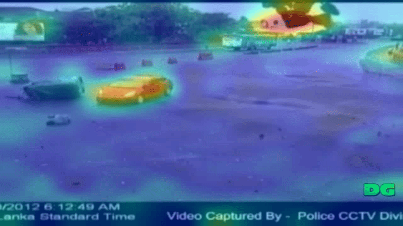

# Real-Time CCTV-Based Traffic Accident Detection for Transportation Safety Monitoring Using Parameter-Efficient Video Transformers

## Overview
This repository implements a real-time CCTV-based accident detection system using parameter-efficient video transformers (Binary ViViT + LoRA).

--------------------------------------------

## Dataset
CADP data: https://ankitshah009.github.io/accident_forecasting_traffic_camera
 

UTIC: https://www.utic.go.kr/guide/utisRefCctv.do

Generalization: UCF Crime 101 https://www.crcv.ucf.edu/research/real-world-anomaly-detection-in-surveillance-videos/

--------------------------------------------
## Repository Structure

CCTV_accident_detection/
│
├── assets/

├── cam/

├── models/

├── utils/

├── configs/

└── README.md

--------------------------------------------
## Visualization
We provide attention rollout visualization results.

