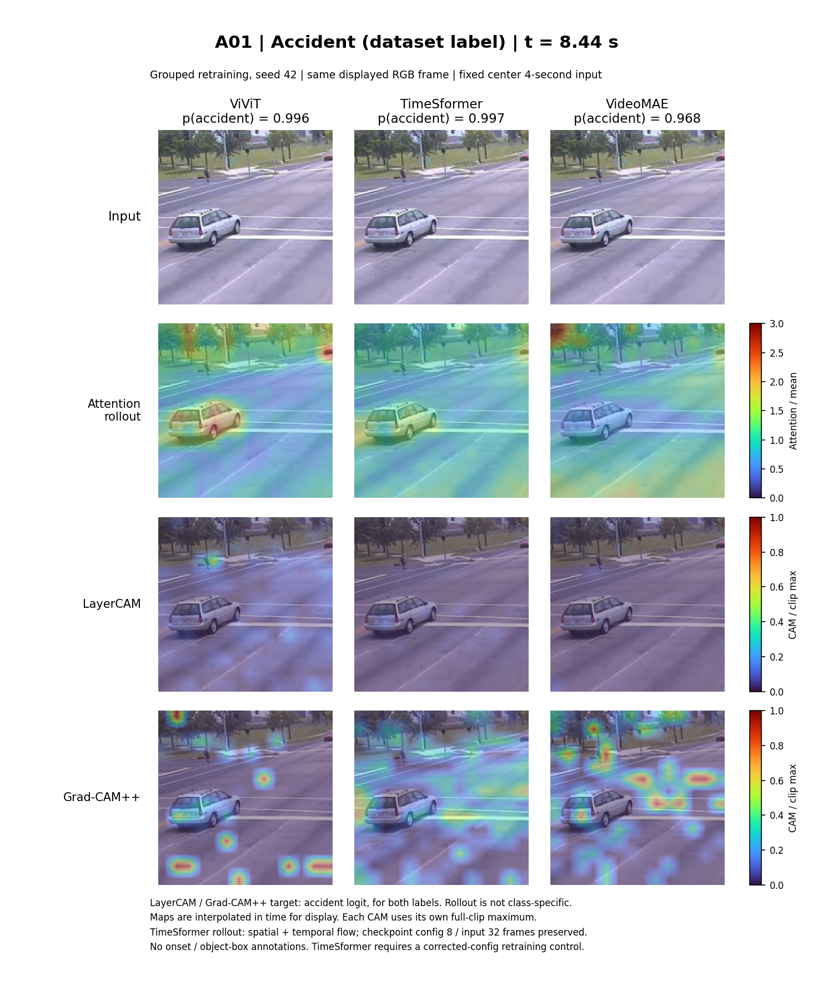
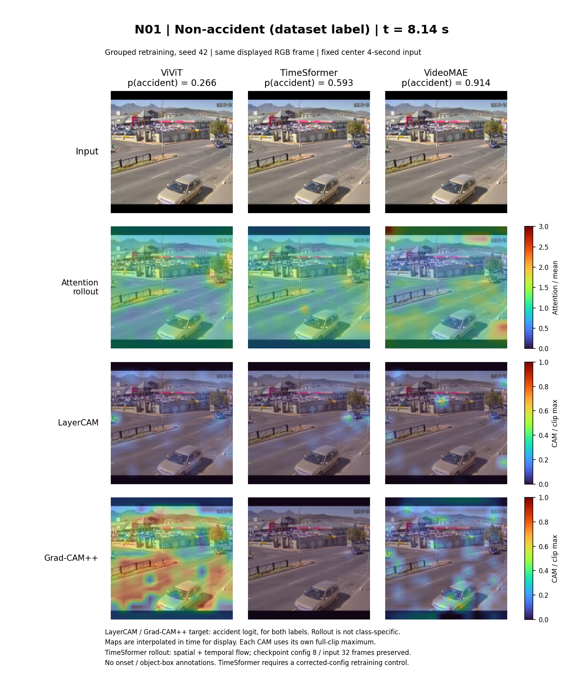

# 사고 10개 · 도로 비사고 10개 시각화

새 grouped 학습 seed 42의 ViViT / TimeSformer / VideoMAE를 원고의 **attention rollout · LayerCAM · Grad-CAM++**로 비교했다.

- [전체 20개 비교표 — 20쪽 PDF](all_20_comparisons.pdf)
- [사고 10개 상세 — 40쪽 PDF](accident_10_details.pdf)
- [도로 비사고 10개 상세 — 40쪽 PDF](nonaccident_10_details.pdf)
- [오프라인 HTML 갤러리](index.html): 이 폴더를 내려받아 브라우저에서 연다.
- [측정값 CSV](diagnostics.csv), [생성 신호 집계](summary.json)

상세 PDF는 사례마다 4쪽이다: 세 모델 × 세 방법 비교표 1쪽, 방법별 네 시점 비교 3쪽. 비교표의 열은 ViViT / TimeSformer / VideoMAE, 행은 원본 / attention rollout / LayerCAM / Grad-CAM++다.

**TimeSformer 주의:** 입력은 32프레임이지만 기존 checkpoint의 내부 attention 설정은 8프레임이었다. 기존 모델 동작을 유지하고 토큰 순서를 역변환해 표시했다. 올바른 32프레임 설정의 재학습 통제 전까지 모델 구조 자체의 우열을 판단하면 안 된다.

사고는 기존 세 예시·격리 후보·중복 그룹을 제외한 추가 10개다. 비사고는 UCF 정상 후보 80개의 중앙 원본 화면에서 차량이 있는 도로·교차로가 분명한 10개를 Codex가 예비 선별했다. 모두 UCF 데이터 라벨이며 사람이 전체 영상의 사고 부재를 재판정한 표본은 아니다. 맵의 모양이나 점수로 고르지 않았다.

CAM의 target은 양성·음성 모두 **사고 logit**이다. 비사고 맵은 정상 판정의 근거를 뜻하지 않는다. 표시 확률은 중앙 4초 구간 값이며 전체 영상 평가 점수가 아니다. 색은 상대 강도이고 사고 시작 시각·객체 box가 없어 localization 정확도를 검증한 결과도 아니다. 앞서 보여준 gradient × input은 원고에 없는 추가 진단이며 이 묶음에는 포함하지 않았다.

세 모델 × 세 방법 × 20사례의 180개 맵이 모두 유한·비음수·양의 신호를 생성했다. 이는 설명의 정확성이나 운영 적합성을 입증하지 않는다. 재현 코드·설정·후속 실험은 [CAM_COMPARISON_20.md](../CAM_COMPARISON_20.md)에 기록했다.

| 사고 비교 이미지 | 도로 비사고 비교 이미지 |
|---|---|
| [A01](A01_comparison.png) | [N01](N01_comparison.png) |
| [A02](A02_comparison.png) | [N02](N02_comparison.png) |
| [A03](A03_comparison.png) | [N03](N03_comparison.png) |
| [A04](A04_comparison.png) | [N04](N04_comparison.png) |
| [A05](A05_comparison.png) | [N05](N05_comparison.png) |
| [A06](A06_comparison.png) | [N06](N06_comparison.png) |
| [A07](A07_comparison.png) | [N07](N07_comparison.png) |
| [A08](A08_comparison.png) | [N08](N08_comparison.png) |
| [A09](A09_comparison.png) | [N09](N09_comparison.png) |
| [A10](A10_comparison.png) | [N10](N10_comparison.png) |

## MP4 비교 영상

[사례별 20개 MP4와 사고·비사고 묶음 영상](videos/README.md)을 추가했다. 기존 PNG는 입력 구간의 약 2/3 시점이며, MP4는 같은 중앙 약 4초 구간 시작부터 재생한다. 맵은 기존 16/32개 측정 시점 사이를 보간했다.
